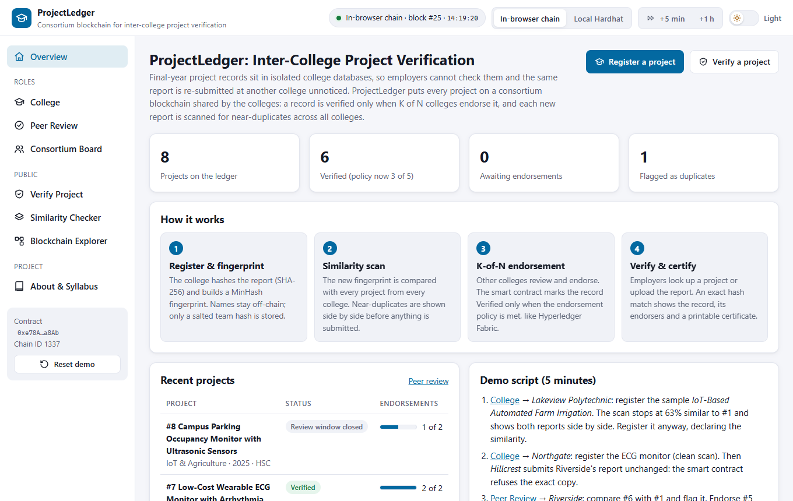
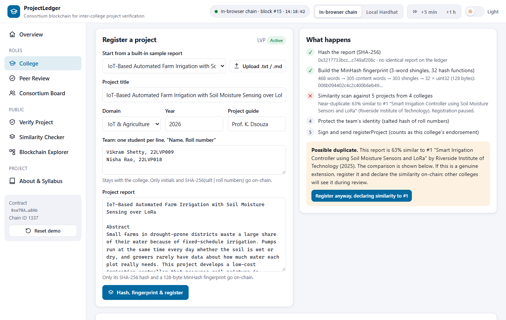
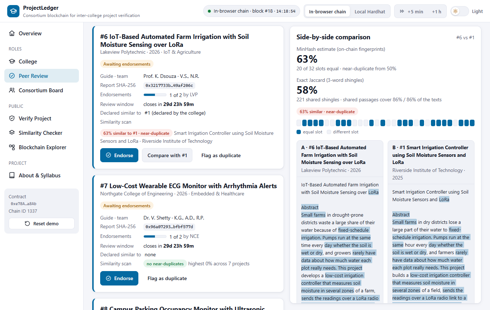
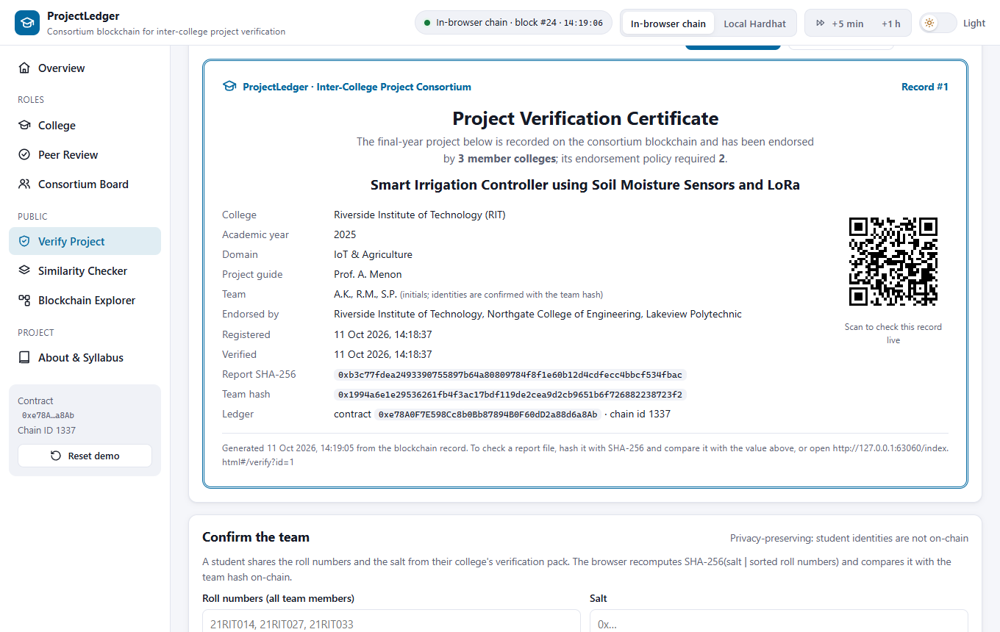
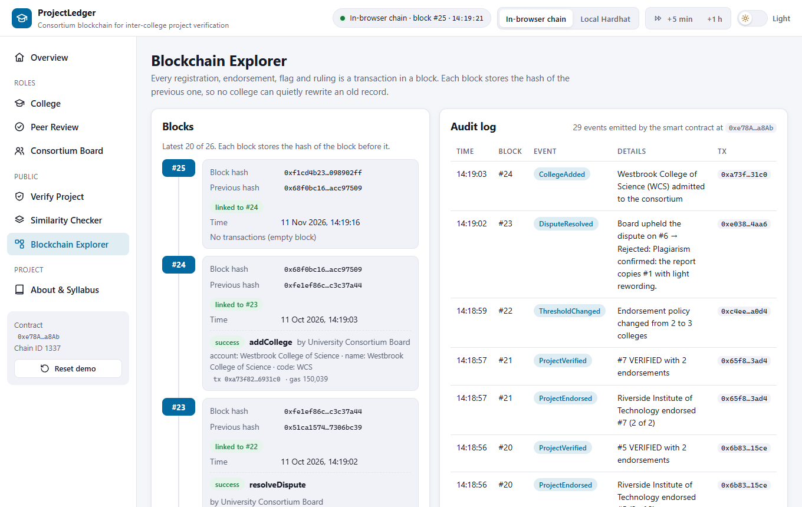
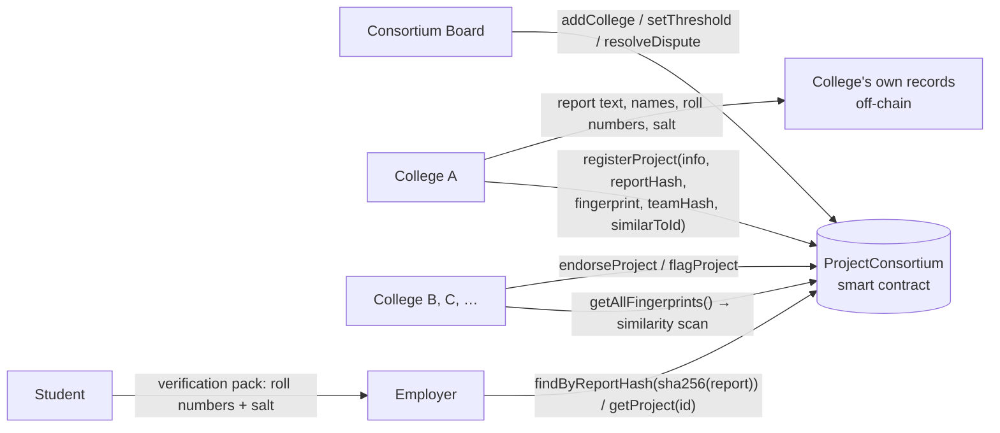

# ProjectLedger: Consortium Blockchain for Inter-College Project Verification

A blockchain shared by several colleges where a final-year project becomes **Verified only when K of N colleges endorse it**, every new report is **scanned for near-duplicates across all colleges**, and employers can **verify a project and print a certificate** without an account.

**Live demo:** https://syedareeb06.github.io/inter-college-project-verification/ (runs entirely in your browser: no wallet, no install, no real cryptocurrency)



---

## The problem

Final-year project records live in isolated college databases. Today:

- an employer or university cannot easily check that a student really did the project on their CV,
- the same report is re-submitted, lightly reworded, at another college or in a later year, and nobody notices because no college can see the others' records, and
- a single college can certify anything about its own students.

## The solution

| Step | What happens | Technique |
|---|---|---|
| 1. Register & fingerprint | The college hashes the report and builds a 128-byte similarity fingerprint. Student names and roll numbers stay with the college; only initials and a **salted team hash** go on-chain. The registering college counts as the first endorsement. | SHA-256, MinHash |
| 2. Similarity scan | Before submitting, the new fingerprint is compared with **every project of every college** on the ledger. A near-duplicate (50% or more) pauses registration and shows both reports **side by side** with the shared passages highlighted. An identical report is refused by the smart contract itself. | MinHash over 3-word shingles, Jaccard similarity |
| 3. K-of-N endorsement | Other colleges review and endorse. The contract marks the record **Verified** when the endorsement policy is met (default: own college + 1 other). Any college can **flag** a suspected copy; the **consortium board** rules on the dispute. | Smart contract endorsement policy (Hyperledger Fabric idea on an EVM chain) |
| 4. Verify & certify | An employer enters a project ID or uploads the report. An exact SHA-256 match shows the record, its endorsing colleges and its status, with a **printable certificate** and a QR code. A student can prove team membership with the salt from their verification pack. | Hash lookup, salted hash check |

## Features

- **College**: register a project with live steps (hash → fingerprint → similarity scan → team hash → transaction); built-in sample reports, or paste / upload a `.txt` / `.md` report; list of the college's records with report download, verification pack and revoke
- **Peer Review**: projects from other colleges with an automatic similarity scan computed from on-chain fingerprints; endorse, compare side by side (MinHash slots, exact Jaccard, highlighted passages) or flag as a duplicate; *Skip 31 days* to show the review window closing
- **Consortium Board**: set the endorsement threshold K, admit / suspend colleges, rule on disputes with the evidence side by side
- **Verify Project** (public): look up by ID (also as a link `#/verify?id=N`) or check a report file; record, endorsers, flags; printable and downloadable certificate with QR code; team check from roll numbers + salt
- **Similarity Checker**: compare any two reports, or scan a text against every fingerprint on the ledger
- **Blockchain Explorer**: hash-linked blocks, decoded transactions and a human-readable audit log
- 8 fictional sample reports built in, including a lightly reworded copy of another college's report
- Light / dark theme switch in the top bar; works on phones (no horizontal scrolling at 390 px)
- Two blockchains: an **in-browser Ethereum chain** (zero setup) or a **local Hardhat node**

| College: near-duplicate found before registering | Peer review: side-by-side comparison |
|---|---|
|  |  |

| Verification certificate | Blockchain explorer |
|---|---|
|  |  |

## Syllabus mapping (22CS743, Blockchain Technology)

| Module | Concepts | Where they appear in this project |
|---|---|---|
| **II** | SHA-256, hash-based similarity (MinHash), a simple agreement rule, hash-linked blocks | SHA-256 of the report and salted team hash; MinHash fingerprint over 3-word shingles with 32 hash functions; "K of N endorsements" as the rule for accepting a record; the explorer checks each block's previous-hash link |
| **III** | Ethereum, EVM, smart contracts, signed transactions | `ProjectConsortium.sol` enforces the endorsement policy, unique report hashes, the 30-day review window and the dispute rules; every registration, endorsement, flag and ruling is a transaction signed by that college's (or the board's) account |
| **IV** | Consortium blockchain, endorsement policy as in Hyperledger Fabric | Only colleges admitted by the board take part; a project needs endorsements from K member organisations, like a Fabric policy `OutOf(2, 'RIT.member', 'NCE.member', …)`. The demo runs on an EVM chain; see the note below |
| **V** | Applications in education, privacy, fraud detection, access control | Verifiable academic records and certificates; plagiarism detection across colleges; only hashes and initials on-chain; role checks for the board and colleges |

**Note on Hyperledger Fabric.** In Fabric, endorsing peers of several organisations simulate and sign a transaction proposal *before* it is ordered, and peers check the endorsement policy when they commit it. This project runs on Ethereum (EVM). The policy is emulated by the contract: each endorsement is a separate signed transaction, and the contract switches the record to *Verified* when the count reaches K. The effect is the same for this use case (no college can certify its own project alone), but endorsements happen after ordering, one block at a time.

## Architecture



**On-chain:** colleges, the threshold, project title, domain, year, guide, team initials, report SHA-256, MinHash fingerprint (128 bytes), team hash, endorsements, flags and rulings.
**Off-chain:** the full report, student names and roll numbers and the team salt, kept by the college.

### Design notes

- **Statuses:** `Pending` → `Verified` (endorsements ≥ the threshold in force when the project was registered); any other college can flag a `Pending` or `Verified` project → `Disputed`; the board upholds (`Rejected`, final) or dismisses (back to `Verified` or `Pending`). The owner can `Revoke` (not while disputed). A `Pending` project whose 30-day review window has passed is reported as `Expired` by `statusOf()`.
- **Exact copies:** `registerProject` reverts with `DuplicateReport(existingId)` if the report hash is already on-chain. The only exception: a college may re-register a report whose earlier record it revoked itself. A rejected report stays blocked.
- **MinHash fingerprint:** text → Unicode words in lower case, common stop words removed → 3-word shingles → FNV-1a 32-bit base hash x → 32 functions h<sub>i</sub>(x) = (a<sub>i</sub>·x + b<sub>i</sub>) mod 4294967311 with a<sub>i</sub>, b<sub>i</sub> from the PRNG mulberry32(22743) → minimum per function → 32 × uint32 big-endian = 128 bytes. Similarity = equal slots / 32 (about ±9 points). 50% or more is a near-duplicate; the side-by-side view also shows the exact Jaccard similarity and the shared passages when both texts are available. The built-in reworded copy scores 63% (exact Jaccard 58%; shared passages cover 86% of the text); unrelated reports score 0%.
- **Team privacy:** `teamHash = SHA-256(salt | roll numbers sorted and joined by ",")` with a random 16-byte salt kept by the college. The student's verification pack contains the salt so that an employer can recompute the hash; without the salt, roll numbers cannot be guessed from the chain.
- **Report hash:** SHA-256 of the report text in UTF-8 with LF line endings (CRLF files are normalised first).
- **Policy changes:** `setThreshold(k)` needs 2 ≤ k ≤ active colleges and applies to projects registered afterwards; suspending a college is refused if fewer active colleges than the threshold would remain.

## Tech stack

- **Smart contract:** Solidity 0.8.24, Hardhat (local blockchain, 22 tests, deployment)
- **Frontend:** HTML, CSS, JavaScript (no build step), ethers.js v6, Web Crypto API (SHA-256), qr.js (MIT) for the certificate QR code
- **Demo blockchain:** Ganache running inside the browser (same EVM, same contract)
- **Hosting:** GitHub Pages

## Project structure

```
inter-college-project-verification/
├── blockchain/                          # Smart contract project (Hardhat)
│   ├── contracts/ProjectConsortium.sol
│   ├── test/ProjectConsortium.test.js   # 22 unit tests
│   ├── scripts/deploy.js                # deploy + seed the demo consortium and sample projects on localhost
│   ├── scripts/export-artifact.js       # copy ABI + bytecode into the web app
│   └── hardhat.config.js
├── frontend/                            # Web app (open index.html)
│   ├── index.html
│   ├── css/
│   ├── js/app.js                        # ProjectLedger screens and logic
│   ├── js/projectledger-crypto.js       # SHA-256, MinHash, overlap highlighting, team hash
│   ├── js/projectledger-samples.js      # fictional sample reports + seed plan (also used by deploy.js)
│   ├── js/chain.js                      # in-browser chain / local Hardhat connection
│   ├── js/contract-artifact.js          # compiled contract (generated)
│   └── vendor/                          # ethers.js, Ganache, qr.js (browser builds)
├── docs/screenshots/
└── index.html                           # redirects GitHub Pages to frontend/
```

## How to run

### Option 1: Zero install (recommended for demos)

Open the [live demo](https://syedareeb06.github.io/inter-college-project-verification/), **or** double-click `frontend/index.html`.
An Ethereum blockchain starts inside the page with four colleges and five sample projects already registered. Your data is saved in the browser; click **Reset demo** in the sidebar to start over.

### Option 2: Local Hardhat blockchain

Requires [Node.js](https://nodejs.org/) 18 or newer.

```bash
cd blockchain
npm install
npm run node
```

Keep that terminal open. In a second terminal:

```bash
cd blockchain
npm run deploy
```

Then open `frontend/index.html` and click **Local Hardhat** in the top bar. (If you skip `npm run deploy`, the app deploys the contract and seeds the demo data itself.)

### Run the smart contract tests

```bash
cd blockchain
npm test
```

### After changing the contract

```bash
cd blockchain
npm run export
```

This recompiles and copies the new ABI and bytecode into `frontend/js/contract-artifact.js`.

## 5-minute demo script

1. **College** → *Lakeview Polytechnic*: the sample *IoT-Based Automated Farm Irrigation…* is preselected. Click *Hash, fingerprint & register*. The similarity scan stops: **63% similar to #1** (Riverside's report), shown side by side. Click *Register anyway, declaring similarity to #1*.
2. **College** → *Northgate*: register the ECG monitor sample (clean scan). Then *Hillcrest*: choose Riverside's *Smart Irrigation Controller* sample and register it. The smart contract refuses it: **"this exact report is already registered as project #1"**.
3. **Peer Review** → *Riverside*: project #6 shows *63% similar to #1 · near-duplicate*. Click *Compare with #1*, then *Flag as duplicate*. Endorse #5 and #7: they become **Verified**.
4. **Consortium Board**: enter threshold 5 → **blocked** (only 4 colleges). Set 3. Open the dispute evidence and click *Uphold*: #6 is **Rejected**.
5. **Verify Project**: look up #1 → certificate with QR code → *Print certificate*. Load the *IoT-Based…* sample and *Check report*: exact match with #6, **Rejected, no certificate**.
6. **Peer Review**: *Skip 31 days*, then try to endorse a waiting project: **"the 30-day review window … closed"**.
7. **Blockchain Explorer**: the hash-linked blocks and the audit log.

## Publishing on GitHub Pages

1. Push this folder to a GitHub repository named `inter-college-project-verification`.
2. On GitHub: **Settings → Pages → Build and deployment → Source: Deploy from a branch → Branch: `main`, folder: `/ (root)` → Save**.
3. After about a minute the site is live at `https://syedareeb06.github.io/inter-college-project-verification/`.

## Limitations and future work

- MinHash detects copied wording. A fully paraphrased or translated report will not match; that would need semantic similarity (sentence embeddings).
- With 32 slots the estimate has an error of about ±9 points, so the scan only raises a flag; colleges and the board decide after reading both reports. More slots would be more precise but cost more storage.
- Fingerprints are public. They do not reveal the text, but someone holding a candidate text can test whether it is on the ledger.
- In the demo every college's off-chain records live in this browser, and colleges sign with demo accounts. Real colleges would keep reports in their own repositories and sign with hardware wallets.
- A production deployment would run on a permissioned network operated by the colleges, such as Hyperledger Besu or Fabric.

## License

MIT, see [LICENSE](LICENSE). The bundled qr.js is MIT licensed (see `frontend/vendor/qr.js.LICENSE.txt`).
